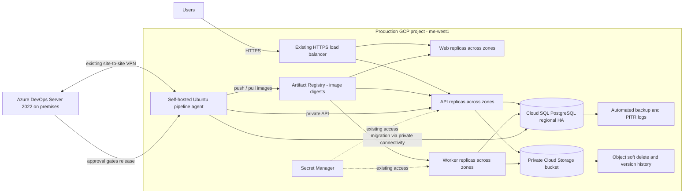

# GCP Cloud DevOps Engineer — proposed solution

## Scope and assumptions

The existing VPN, HTTPS entry point, attached agent identity, Workload Identity and Secret Manager access remain in place. Azure DevOps Server 2022 remains the source and CI/CD platform; GitHub is only the submission destination. No development environment, cloud deployment or paid service is required. Examples assume HTTP API endpoints that the application team implements; request sizes, shutdown timing, namespace, image paths, permissions and capacity must be measured and adapted. The worker processes jobs safely across retries and is deployed separately; if it does not, idempotency and queue recovery must be designed before scaling it.

The 15-minute database RPO and two-hour RTO are objectives, not guarantees derived from configuration. A whole-region outage is out of scope; the design below addresses a single-zone outage. The proposed changes are not applied to a real environment. Local checks are listed at the end.

## Corrected architecture



Arrows show logical communication, not all network hops. Workload Identity and the agent's attached service account are existing identity controls; no key files are introduced. Protect and monitor the single build agent: its loss blocks delivery, not necessarily already-running production traffic.

## 1. Release safety and availability

**Cause/risk.** One API replica and absent readiness checks allow traffic to hit a starting or terminating pod; maintenance can remove the only serving instance. Two nodes in one zone also share a failure domain.

**Fix.** The [example](api-availability.yaml) uses three API replicas, startup and readiness probes, resource requests/limits, a rolling update with `maxUnavailable: 0`, `maxSurge: 1` and `minReadySeconds: 10`. Startup prevents premature readiness evaluation; readiness removes an unready pod from service endpoints. The API must respond ready only when it can serve, avoid overly sensitive dependency checks, and implement real graceful SIGTERM handling: stop accepting new work, drain in-flight requests and exit within the 60-second grace period. Confirm load-balancer/endpoint propagation and connection-draining timings in this environment; add a tested preStop delay only if required and account for it within the grace period. No liveness probe is proposed without a reliable signal, to avoid restart loops.

The example PDB requires two available replicas during voluntary evictions. It does not prevent zone failures or control Deployment rolling updates; the rollout strategy does the latter. Zone spread is strict and host spread is preferred. Reserve sufficient schedulable capacity for three replicas plus one surge pod, including during a zone failure; resource values are starting assumptions, not measurements. Strict topology constraints can leave pods pending if capacity or eligible zones are insufficient. Apply comparable measures to the frontend and worker, with worker-specific graceful job completion and retry/idempotency. Do not assume web, API or worker scaling alone fixes shared-state limits.

**Zone failure, separate from deployment fix.** Today both nodes and the zonal database can disappear together. Use a regional GKE cluster/node pool with nodes spread across at least two zones, with surviving-zone capacity sized for the required load and rollout headroom. Configure Cloud SQL regional HA in the same region with a standby in another zone and test failover/reconnection. GKE rescheduling and Cloud SQL failover take time and connections can break; application retries must be bounded and safe. This improves single-zone resilience, not regional disaster recovery. Cloud Storage's actual bucket location and service behavior must be verified against availability requirements. The agent can remain a delivery single point of failure; it does not belong in the serving path.

**Verify.** Load-test a continuous mix of requests during repeated rollout and `kubectl drain` of one node; record availability, errors, latency, endpoint readiness, pod placement and shutdown duration. Exercise a slow startup and an unready pod; check stalled rollout and rollback. In an authorized real test, simulate a zonal loss and Cloud SQL failover, verify surviving capacity, retries, error duration and recovery. Do not claim zero downtime solely from the YAML.

## 2. Recovery from deletion at 10:20, discovered at 10:35

**Current limits.** A daily backup can lose nearly a day of database changes; without PITR there is no supported recovery to just before 10:20. With neither bucket versioning nor soft delete, deleted objects cannot be assumed recoverable. Untested backups provide no demonstrated RTO.

**Prepare.** Enable automated backups and PostgreSQL PITR with transaction-log retention sufficient for the seven-day operational recovery window; monitor backup success, transaction-log availability and storage. Confirm edition-specific limits, restore permissions, encryption and private connectivity. Enable a Cloud Storage soft-delete retention of at least seven days and object versioning for overwritten objects; establish a lifecycle policy that does not remove needed noncurrent versions prematurely. Test version-specific restoration and access controls; account for storage cost. Store object name **and generation** in each DB record and retain manifests/audit evidence that maps logical records to generations. Coordinate uploads and database commits using an idempotent state machine or outbox/reconciliation process: GCS and PostgreSQL are not one atomic transaction. Record deletion/audit times and use UTC for the actual incident. Restrict destructive access and alert on backup/log failures and deletions.

**Recovery procedure.**

1. Declare incident, record timestamps and start RTO clock. Stop writes, uploads, background jobs and scheduled cleanup; preserve evidence and access to the original instance/bucket. Prevent clients from writing while consistency is being restored.
2. Select a recoverable UTC point immediately before the first harmful database transaction, e.g. 10:19:59 only if evidence confirms it precedes all affected transactions. Check the actual latest restorable timestamp and transaction logs. Restore PITR to a **new** Cloud SQL instance with compatible network, identity, flags and capacity; do not overwrite the original.
3. In an isolated validation context, compare restored DB records and object-generation references against inventory and audit logs. Restore each required deleted object or required historical generation to a controlled location; avoid blindly replacing current live objects. Reconcile missing objects, orphaned objects and uploads/updates between the selected recovery point and write freeze. If later legitimate transactions are recoverable from authoritative logs or another durable source, replay only after validation; otherwise explicitly report their loss. Do not claim automatic cross-service atomic recovery.
4. Validate schema version and application compatibility, record counts and representative records, object content/checksums, read/write permissions, and a synthetic end-to-end upload/report. Decide cutover only once missing or conflicting data is resolved or accepted by the incident owner.
5. Reconfigure the application securely to the restored instance, restart/reconnect connection pools and workers, run a smoke test, then reopen traffic and monitor errors and reconciliation. Preserve the former DB until the retention and incident policy permits cleanup. Record actual RPO, RTO and any residual loss.

**Prove targets.** Repeat timed drills with synthetic transactions and object uploads/deletes, including deletion and overwrite, on representative data volume. Measure recovery-point gap against the latest legitimate transaction and elapsed time from incident to validated service restoration; compare to 15 minutes and two hours. A restore to 10:19:59 may discard valid writes after that time until 10:35 or later, so this scenario can exceed the RPO even if PITR logs are current. Achieving both targets requires a tested selective recovery/replay process and a recovery point and write-freeze strategy that limits actual lost valid transactions; if evidence or replay is inadequate, report the target as unmet. Test restoring objects for the full retention period and investigate gaps. PITR/HA does not undo accidental deletion by itself.

**Optional future improvement — regional disaster recovery.** If the business requires recovery from loss of the entire region, evaluate a cross-region Cloud SQL replica and independent cross-region protection for objects, with a documented promotion, application/network cutover and consistency procedure. This is beyond the requested single-zone scenario and adds cost and operational complexity. Replication can propagate accidental deletions and is not a substitute for backups, PITR or object retention. Check actual replication lag, configuration, regional availability and restore capabilities, then measure RPO/RTO with a full drill before making any commitment.

## 3. Full Linux build agent

**Diagnosis.** Confirm the filesystem and inode situation, then locate reclaimable data without deleting live workloads:

```bash
df -hT /; df -i /
sudo du -xhd1 /var/lib/docker /opt/ado-agent/_work | sort -h
docker system df -v
docker ps -a --size
docker volume ls
sudo lsof +L1                    # deleted files still held open
sudo journalctl --disk-usage
```

Check active builds, agent pool concurrency, running containers, local image/layer reuse, volumes, build cache, workspace ownership, retention needs and any other consumers first. Volumes may contain the only copy of important state; do not use `--volumes`, prune indiscriminately, or delete directories belonging to an active job. Confirm agent service account permissions and available disk before intervening.

**Safe recovery.** Disable this agent in the Azure DevOps pool and let active jobs finish or coordinate cancellation. Preserve relevant logs/artifacts and verify no production workload runs here. Inspect `docker system df -v` and prune only confirmed unused cache/images using conservative age filters, e.g. `docker builder prune --filter 'until=168h'` and `docker image prune -a --filter 'until=168h'`, after understanding that unused cached images will need rebuilding. Clean only confirmed abandoned job workspaces through the agent's supported cleanup/retention settings, or selectively after verifying ownership and no active job. If space is insufficient, expand the disk/filesystem or move the agent cache to a properly provisioned volume. Recheck `df`, restart the agent only if needed, enable it and run a controlled test build. Never remove Docker's storage tree manually.

**Prevent.** Monitor free bytes and inodes with actionable thresholds, Docker cache and workspace trends; use retention/cleanup on a drained or otherwise safe agent, bounded caches, log rotation and capacity planning. Test cleanup scheduling and maintain build availability with a second agent if required.

## 4. Safe delivery and failed migration

**Cause/risk.** `latest` does not identify what is running or previously worked. A successful database migration survives an application rollback, so an incompatible schema can break the old version.

**Flow.** PR build validation runs tests and checks; after merge, build once, tag with unique build ID and push to Artifact Registry, resolve and persist its immutable digest plus source commit. Promote that same digest, not a rebuilt image. A protected production environment requires a named independent approval and restricted pipeline/service-connection permissions. Acquire an exclusive release lock; before migration persist the current production digest and DB migration revision in a durable release ledger. Apply a reviewed, preferably backward-compatible migration once; deploy by digest; monitor rollout, run realistic smoke checks and record release status. Failure stops promotion and alerts the operator. [Pipeline excerpt](azure-pipelines-example.yml) labels environment-specific commands as pseudocode. Validate approval, exclusive-lock and artifact syntax against the installed Server 2022 update before use; configure controls outside repository YAML.

**Recovery.** Stop further deployments, capture symptoms, determine actual running digests and migration revision. If schema is compatible, redeploy the recorded last-known-good digest, wait for rollout and validate service and data. For this initial incident the digest was not recorded: inspect Kubernetes ReplicaSets, pod `imageID`, rollout history, registry metadata and retained logs for a verifiable digest. `latest` alone is not evidence; if the old digest cannot be proven, rebuild the known previous commit in a controlled way and validate the resulting image, or fix forward. Do not claim it is byte-identical to the original.

If the migration is incompatible, old code may not work against the current schema: prefer a tested forward fix or a reviewed compensating migration. A DB PITR restore is a last-resort recovery decision with potential loss of later writes and must include the file consistency procedure above. Use expand/contract migrations across releases: add compatible schema, deploy code supporting both, backfill and verify, then remove old schema only after old versions are retired. Test both rollout and rollback against each transitional schema.

## 5. Git controls and urgent fixes

Use short-lived feature branches and PRs into protected `main`. Azure Repos branch policies: minimum reviewer count (at least one independent reviewer), build validation with tests/lint/security checks, and comment resolution; reset approval on new changes according to the installed version. Deny direct pushes and restrict bypass permissions. Only a successful merge to `main` creates a candidate release; it does not itself bypass the separately configured production environment approval. Restrict who can edit pipeline definitions, environment checks and service connections. An urgent fix uses a short-lived hotfix branch, the same required checks and independent review, followed by the same production approval and a documented expedited response. Keep policy bypass a separately governed emergency procedure, not the normal hotfix flow.

## Evidence and validation status

Local checks: YAML parsing and a structure review of the diagrams/snippets, if available, are reported in the accompanying discussion guide. No GCP resources, Azure DevOps Server, actual cluster, restore, load test, deployment, or failover were exercised. All service-specific behavior and the RPO/RTO remain proposals until tested in the real environment.

References: [Kubernetes rolling updates](https://kubernetes.io/docs/tasks/run-application/update-deployment-rolling/), [pod disruption budgets](https://kubernetes.io/docs/concepts/workloads/pods/disruptions/), [Cloud SQL HA](https://cloud.google.com/sql/docs/postgres/high-availability), [Cloud SQL restore](https://cloud.google.com/sql/docs/postgres/backup-recovery/restore), [Cloud Storage lifecycle/versioning behavior](https://cloud.google.com/storage/docs/lifecycle), [Azure Repos branch policies](https://learn.microsoft.com/azure/devops/repos/git/branch-policies?view=azure-devops), [Azure DevOps Server 2022 release notes](https://learn.microsoft.com/azure/devops/server/release-notes/azuredevops2022).
